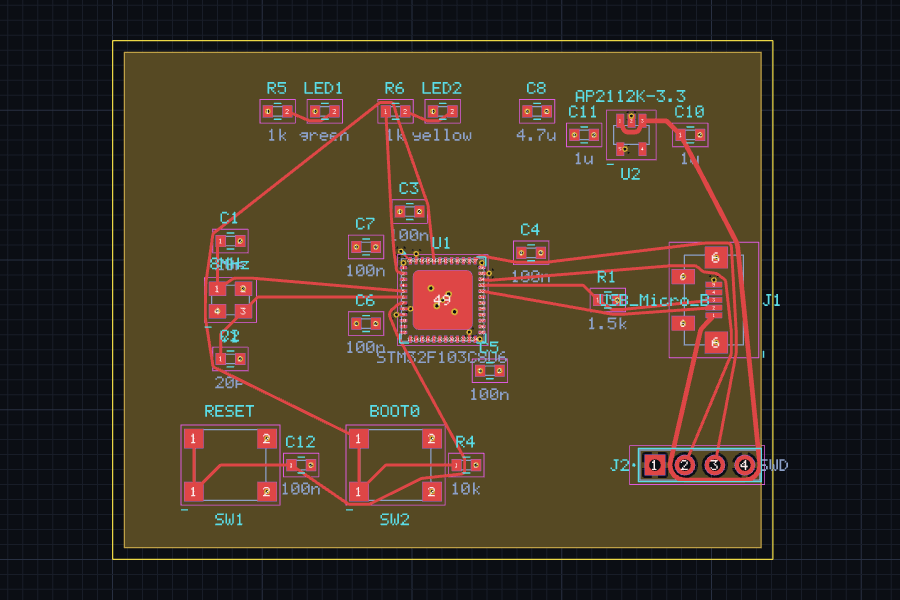
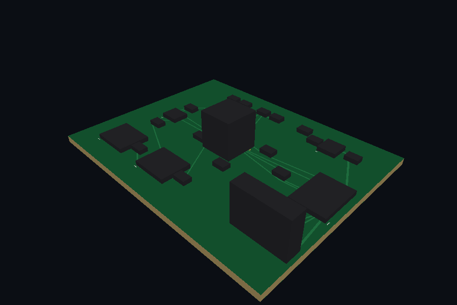

# Validation project: a real board (roadmap stage 47)

Stage 47 added **no features on purpose**. A reference board was taken through the whole ButureCAD
flow to find what breaks; BLOCKER and CRITICAL findings were fixed, the rest is listed below.




*Both images are real renders of the committed project (the PCB view of the desktop renderer and
the software 3D preview). The long diagonal tracks are real: see MAJOR-2.*

## The board

`examples/reference-board/` — a 56 × 44 mm, **4-layer** USB microcontroller board.

| Part | Role |
|---|---|
| U1 STM32F103C8U6 (UFQFPN48) | microcontroller |
| J1 USB Micro-B, R1 1.5 k | USB with D+ pull-up |
| U2 AP2112K-3.3 (SOT-23-5), C8, C10, C11 | 5 V → 3.3 V regulator and bulk/input/output capacitors |
| Y1 8 MHz + C1, C2 | crystal |
| C3–C7, C12 | 100 nF decoupling and reset filter |
| LED1 (power), LED2 (PC13) + R5, R6 | LEDs |
| SW1 (reset), SW2 (BOOT0) + R4 | buttons |
| J2 | SWD programming header |

Layers: F.Cu signals, In1.Cu GND plane, In2.Cu +3V3 plane, B.Cu signals. 24 components, 14 nets in
the netlist after supplies, 56 plated holes.

| File | What |
|---|---|
| `board.beda` | the design as ButureScript (schematic, nets, footprints, placement, rules, planes) |
| `libraries/Ref.bsymlib.json`, `Ref.bfplib.json` | symbols and footprints for the parts the built-in set lacks. Pin numbering of the MCU follows the public STM32F103x8 datasheet; drawings and **land patterns are our own and nominal**. Regenerate with `cargo run -p buturecad-libraries --example reference_libs -- examples/reference-board/libraries` |
| `project/` | the generated, routed project |

**Not for fabrication.** The footprints were not checked against datasheets and there is no
fabricator sign-off.

### How it was made (and what was manual)

```bash
buturecad build examples/reference-board/board.beda --out project   # schematic + footprints + nets + placement + planes
cargo run -p buturecad-cli --example route_reference -- project     # routing (validation harness, see below)
buturecad fill project                                              # refill zones
buturecad erc project ; buturecad drc project
buturecad export-gerber project --out fab
```

* Placement was written by hand in the script (several rounds, driven by DRC/routing results).
* **Routing used `apps/cli/examples/route_reference.rs`**, a throw-away validation harness: ButureCAD
  has no headless routing command, routing is interactive in the desktop app. The harness drives the
  same router crate and Command Engine (walk-around legs on F.Cu, escape vias and B.Cu when needed,
  vias into the planes). It is not a product feature and not an autorouter to rely on.
* The tests `apps/cli/tests/reference_board.rs` and `apps/desktop/src-tauri/tests/reference_board.rs`
  keep the result honest: script builds, connectivity matches the script, DRC has 0 errors, ERC has
  exactly the known findings, every Gerber parses with the independent reader, drill hits = vias +
  plated pads, BOM/position counts, the board is drawn in PCB and 3D.

## Results of the flow

| Step | Result |
|---|---|
| Schematic (from script) | ✔ builds; generated as parts with net markers, no drawn wires (documented limit) |
| ERC | ✘ **31 errors**, all `unconnected_pin` (30 unused MCU I/O pins + USB `ID`), plus a warning for the PWR_FLAG without footprint. See MAJOR-1 |
| Footprint assignment | ✔ generators + library footprints |
| PCB, placement | ✔ no courtyard collisions |
| Routing | ✔ complete with the harness (21 connections, no unrouted nets) |
| Vias, planes | ✔ 4-layer stack with GND and +3V3 planes, plane vias |
| DRC | ✔ **0 errors, 0 warnings** after `buturecad fill` |
| 3D preview | ✔ draws (component bodies are courtyard boxes) |
| Gerber / drill / BOM / pick-and-place | ✔ 14 files; preflight 0 errors; Gerbers re-read by the independent parser with no warnings |

## Findings

### BLOCKER (fixed)

| # | Problem | Fix |
|---|---|---|
| B1 | **A script could only use the built-in symbols (R, C, L, V, I, D, LED, 2/4-pin connectors) and generated footprints.** No microcontroller, regulator or USB connector could be described in code, so the code-driven flow could not start. | `CompileOptions.symbols/footprints`, `apply_design_with`, `LibraryDir::load_all`. The CLI uses `--libs <folder>` or the `libraries/` folder next to the script. Library pins are checked at compile time like built-in ones. |
| B2 | **No way to refill copper zones headlessly.** After routing outside the GUI the zone fill was stale; DRC reported dozens of false `short` errors and export stayed blocked. | New `buturecad fill <project>` (same `zonefill` code as the app, through the Command Engine). |

### CRITICAL (fixed)

| # | Problem | Fix |
|---|---|---|
| C1 | **The automatic schematic layout could silently short unrelated nets.** Parts were put on a fixed grid; the big MCU symbol overlapped the cells of its neighbours, so pins of U1 landed exactly on the GND / net markers of other parts (U1.11 ended up on GND, U1.30 on another net). The netlist was wrong without any message. | The layout is now by real symbol size (cells never overlap) **and** every build verifies on the real connectivity graph that the schematic connects exactly what the design connects; otherwise it fails with the offending pins. |
| C2 | **The QFN generator made footprints that short themselves**: with 12 pins per side and a 7 mm body, corner pads of adjacent sides overlapped (DRC `short` between pads of one part). | Pad length now follows the geometry; `generate()` refuses overlapping corner pads. Tests added. |

### MAJOR (open)

| # | Problem | Notes |
|---|---|---|
| M1 | **No "no-connect" for pins in ButureScript** (nor ERC waivers from the CLI), so every unused MCU pin is an ERC error. | The schematic editor has no-connect markers; the language/IR do not. |
| M2 | **No headless/automatic routing and the router leaves free-angle diagonals** (no 45° clean-up, documented in `crates/router`); the result is DRC-clean but ugly (see image). The harness run took ~3 min for 66 connections on this small board; failed searches are the slow part (not profiled). | Interactive routing in the app is the intended flow. |
| M3 | **Silkscreen text is not exported** (references/values), so a board comes out without designators. | Stated in the preflight notes. |
| M4 | **BOM has no MPN/manufacturer columns** although components can carry them; the Footprint column of U1 shows the generator call text. | |
| M5 | **Pin names such as `D+`, `D-` cannot be written in a pin reference**; numbers must be used. | Language limit. |
| M6 | **The schematic has no drawn wires** (parts + net markers), so it is a netlist, not a readable drawing. | Documented limit of generated schematics. |

### MINOR

* `zone "+3V3" …` was a syntax error although `connect "+3V3"` worked — **fixed** (quoted net names in `net/track/via/zone`).
* A PWR_FLAG is needed so ERC accepts GND as supplied; being a virtual part it triggers "missing footprint".
* ERC errors do not block `export-gerber` (DRC and preflight do).
* `--json` must come after the subcommand (`buturecad drc project --json`).
* 3D bodies are boxes from the courtyard; STEP models are not parsed.
* Reference/value texts of dense parts overlap in the PCB view.
* Pick-and-place excludes through-hole parts and does not apply per-footprint rotation offsets (stated in `assembly-info.txt`).

## Limits of this validation

One small board, no fabrication, no second opinion of another EDA tool. It exercised
script → schematic → ERC → footprints → PCB → routing → planes → DRC → 3D → Gerber/drill/BOM/pick-and-place,
but not interactive routing in the GUI, hierarchical sheets, differential pairs or length tuning.
